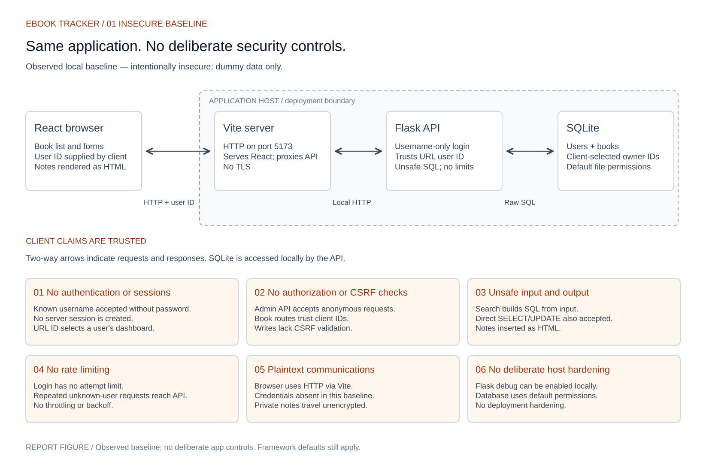
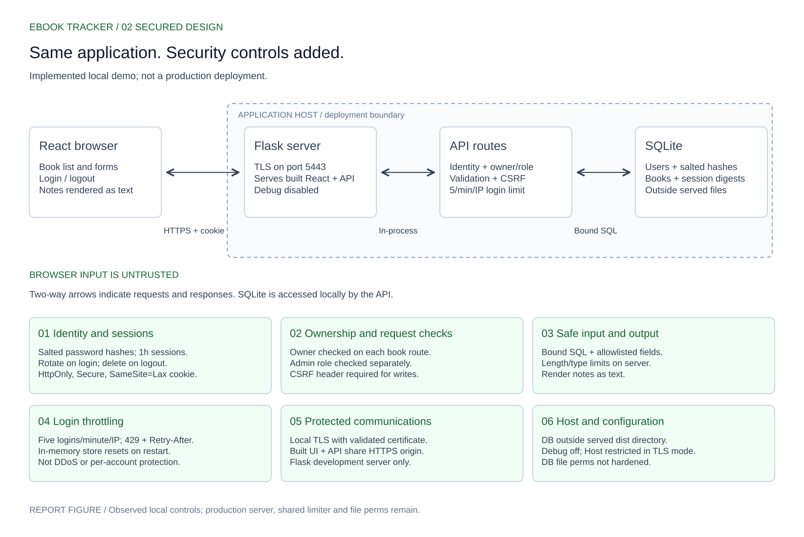
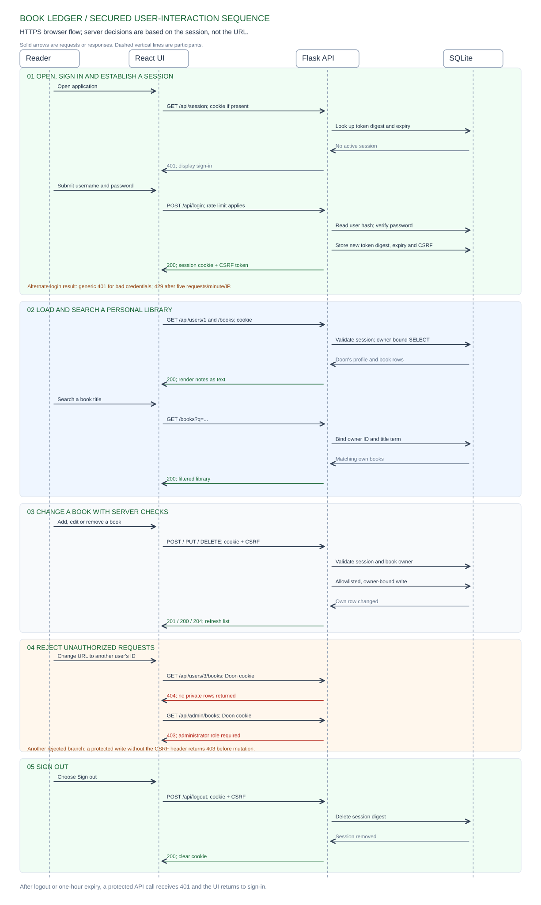
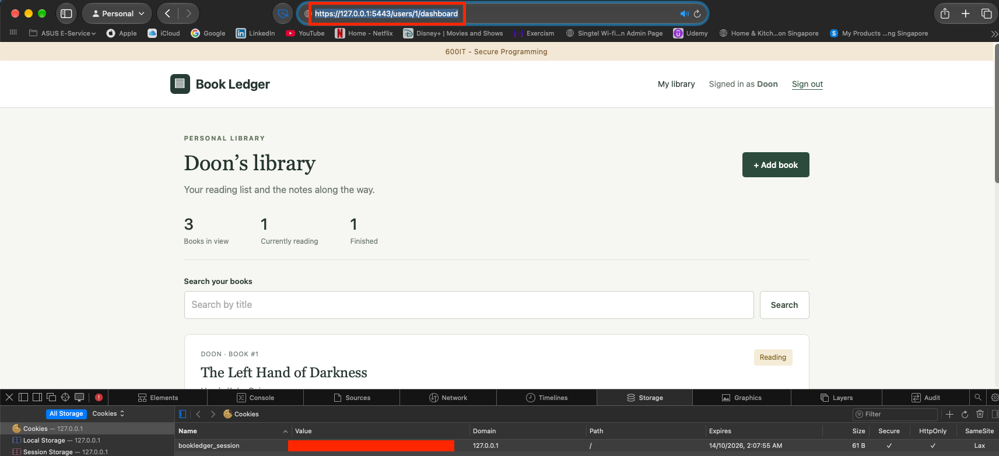

# Secure Personal Ebook Tracker: a before-and-after security study

**Module:** 600IT Secure Programming

**Assessment:** Coursework 2 — secure web-based system

**Candidate:** [Add name and student number]

**Word count:** [Confirm in Word after selecting figures and captions]
**Referencing note:** This draft uses Harvard author–date referencing as requested. The supplied assessment rubric explicitly specifies **APA 7**; convert the citations and reference list to APA 7 before submission unless the current module instructions permit Harvard.

## Introduction and aims

A personal ebook tracker is small enough to expose security decisions without making visual design the main work. It lets a reader sign in, list books, search titles and maintain private notes; an administrator can see a separate overview. Three seeded demonstration accounts—`doon`, `otherdoon` and `admin`—provide distinct identities and data for repeatable tests. The project asks whether a browser can claim another identity, read or change another reader's data, alter a database query, or send unrestricted login requests. It then applies controls where untrusted browser input crosses into the Flask API.

The work uses a before-and-after experiment. Git tag `v0.1.0-insecure` preserves an intentionally vulnerable local baseline; the secure branch adds authentication, session management, authorization, safe data handling, login throttling and localhost HTTPS. The same misuse cases are repeated after each change. All accounts and notes are synthetic. The aim is evidence of specific security properties in a teaching system, not a claim of production readiness.

## Literature review

Security is an engineering property of a whole system, rather than a feature that can be added to its interface. Anderson (2020) treats access control, protocols and assurance as interacting design problems; McGraw (2006) argues that architectural risk analysis and security testing belong throughout software development. The NIST Secure Software Development Framework (SSDF) turns that principle into development practices for preparing, protecting, producing and responding to vulnerabilities (Souppaya, Scarfone and Dodson, 2022). For this project, the security requirements are explicit: only an identified reader may access private notes; an administrator may access the separate overview; untrusted input must not change SQL structure; and credentials and sessions must be protected in transit.

Threat modelling gives those requirements a testable form. Shostack (2014) uses system diagrams to ask what can go wrong at trust boundaries, while Saltzer and Schroeder's (1975) principle of *complete mediation* requires checking each access, not relying on a previous screen or a hidden link. The two Excalidraw diagrams show the same browser–API–database flow before and after controls. They expose a key trust boundary: the browser may choose a URL, JSON body or search string, but the server must decide whose books can be read or changed. A signed-in user selecting another user's ID is a horizontal authorization threat; a regular user requesting `/api/admin/books` is a vertical one (OWASP, 2020).

Standards-based guidance helps select controls, but it is not evidence that an implementation works. OWASP ASVS 5.0 provides a web-application verification framework (OWASP, 2025), and NIST's digital identity guidance calls for salted password hashing and limiting failed authentication attempts (NIST, 2025). OWASP recommends parameterized SQL, per-request authorization and server-side input validation because browser controls can be bypassed (OWASP, n.d.-g; n.d.-b; n.d.-e). Session guidance distinguishes the `Secure` cookie flag, which restricts transmission to HTTPS, from `HttpOnly`, which blocks JavaScript reading the cookie; neither makes cross-site scripting harmless (OWASP, n.d.-f). A server-validated request token adds protection against cross-site request forgery, with `SameSite` acting as defence in depth (OWASP, n.d.-c). These sources justify complementary controls rather than one purportedly “secure” framework setting.

Testing must try to disprove the intended boundary. The OWASP Web Security Testing Guide (WSTG) describes tests for bypassing authorization, weak login lockout, SQL injection, credential transport and cookie attributes (OWASP, 2020). The project pairs each attack request with its HTTP result and, for writes, the database state afterwards. Tools can extend this work: `pip-audit` checks dependencies against known advisories, while ZAP can scan web traffic; neither establishes that a reader cannot access another reader's books, so manual authorization tests remain essential (PyPA, n.d.; ZAP, n.d.). Passing tests demonstrate the specified cases, not universal security.

## System, baseline and threats

The application is a React reading tracker backed by Flask and SQLite. The baseline runs through Vite over local HTTP, with Vite forwarding API requests to Flask. In the secured HTTPS presentation, Flask serves the built React files and API on one localhost TLS origin. SQLite is local to Flask rather than exposed to the browser. Figure 1 depicts the deliberately vulnerable baseline; Figure 2 depicts the implemented local design. The diagrams use the same layout to isolate the security changes. Their Excalidraw sources remain editable.

**Figure 1. Insecure baseline data flow.** Browser-selected IDs and search content reach the API without a reliable identity or ownership decision. [Editable Excalidraw source](diagrams/system-baseline.excalidraw).

**Figure 2. Secured local data flow.** The API derives identity from a server-validated session, checks owner or role, validates writes and binds SQL values. [Editable Excalidraw source](diagrams/system-secured.excalidraw).

**Figure 3. Secured user-interaction sequence.** The reader opens the app, signs in, views and searches their library, changes a book, and signs out. Flask validates the session and ownership before accessing private rows, while writes also require the CSRF token. The orange denial section shows alternative requests that fail; it is not part of the normal reading path. A later page refresh repeats `/api/session` and restores the identity while the session is valid. [Editable Excalidraw source](diagrams/system-sequence.excalidraw).

The main assets are passwords, session tokens, private notes and the integrity of book records. The attacker in this demonstration can use the browser address bar, forms and direct HTTP requests and can know or guess user and book IDs. They cannot read the server's SQLite file or TLS key directly. The key trust boundary is the browser-to-API request: a URL ID, search term or JSON owner field is a claim, not evidence of authority.

| Baseline entry point | Threat | Required outcome after hardening |
| --- | --- | --- |
| Username-only `/api/login` | Impersonation | Wrong credentials yield 401 and no session. |
| Changed `/users/{id}/dashboard` or book ID | Cross-user disclosure or mutation | Another user's records yield 404 and stay unchanged. |
| Direct `/api/admin/books` | Role escalation | No session yields 401; ordinary user 403; admin 200. |
| Search text or whole SQL statement | Query manipulation | SQL-like input remains data; no other user's note changes. |
| Repeated login requests | Application-level guessing and load | Sixth request within the per-IP window yields 429. |
| State-changing request without token | Cross-site request forgery | Missing CSRF token yields 403 before mutation. |
| HTTP carrying a session | Traffic exposure | Local HTTPS is certificate-validated and cookie flags are present. |

The baseline sign-in accepts a known username without a password or server session. Changing the dashboard URL from `/users/1/dashboard` to another user's path reveals that user's books and notes. An unsigned visitor can also request `/api/admin/books`. These are failures of server-side identity and authorization, not merely navigation defects. The ordinary search path interpolates input into SQL. A separate demonstration path goes further and executes complete client-supplied `SELECT` or `UPDATE` statements: the captured `UPDATE` changed three book rows, including another reader's notes. That screenshot proves direct execution of untrusted SQL and missing write authorization; it is distinct from quote-based SQL injection in the interpolated search path. Invalid username attempts are unrestricted, although this passwordless baseline cannot demonstrate password guessing.

**Figure 4. Baseline cross-user access.** The URL selects user 2 while the interface still presents Doon as signed in. The screenshot log contains the accompanying private-note detail.

**Figure 5. Baseline anonymous administrator API.** Directly requesting the endpoint returns records without an identity or role check.

**Figure 6. Direct execution of client-supplied SQL.** The entered `UPDATE` reports three affected rows and changes another reader's note. This is distinct from exploiting the interpolated `LIKE` path with a quote-breaking payload.

## Security implementation

The secure branch replaces username-only entry with password verification against salted hashes. Unknown usernames and wrong passwords return the same generic error, reducing direct account-enumeration clues (OWASP, n.d.-a). Successful login issues a random session token; SQLite stores only its SHA-256 digest, associated user, expiry and CSRF token. Login rotates the session, logout deletes it, and a reload recovers the identity through `/api/session`. In the HTTPS presentation, the cookie has `Secure`, `HttpOnly` and `SameSite=Lax` attributes. These measures protect the session's lifecycle and transport; they do not prevent a script already running on the same origin from making authenticated requests.

For an unknown username, the login code checks a dummy password hash, avoiding a completely separate fast path from known usernames. Both wrong-password and unknown-user responses have HTTP 401 and the same text. The demonstration login page intentionally displays the seeded account names and passwords for assessment convenience, so these particular usernames are public; the generic error illustrates a reusable production pattern rather than hiding the demo accounts. Sessions expire after one hour. The cookie's `Secure` attribute depends on the request arriving through HTTPS: the earlier HTTP development screenshot correctly shows it unset, so only the later HTTPS presentation is used as protected-cookie evidence.

Every personal-book route derives identity from the server session and checks the requested user or book owner. Cross-user reads and writes return 404; the administrator overview separately checks the stored role. Thus a changed URL or guessed ID cannot grant access. Writes require the session's CSRF token in a header. Book creation and updates accept only title, author, status and notes, enforce types and length limits on the server, and reject oversized bodies. Search and mutations bind SQL parameters rather than concatenating client input. React renders notes as text rather than inserting raw HTML. Parameterization addresses SQL interpretation; validation protects data quality and resource use; text rendering addresses script interpretation. None is a substitute for ownership checks (OWASP, n.d.-g; n.d.-b; n.d.-e; n.d.-d).

The authorization checks operate on both route IDs and stored rows. Creation uses the user ID from `current_session()`, not from a submitted owner field. Update and delete SQL include `WHERE id = ? AND user_id = ?`, so guessing a valid book ID does not bypass ownership. The CSRF header is compared with the session's token before a protected write. This token is separate from the `SameSite` cookie setting and is not included in report screenshots. The secured search uses `WHERE b.user_id = ? AND b.title LIKE ?`; typed SQL is treated as a title string, and the owner comes from the server session. A blacklist of SQL words would not provide the same structural guarantee (OWASP, n.d.-g).

The login endpoint allows five requests per minute per connecting IP and returns HTTP 429 with `Retry-After` on the sixth. This slows repeated attempts against the single-process demonstration, but the in-memory counter resets on restart, is not shared across workers and does not prevent distributed guessing or network-level denial of service. In particular, it is **not** NIST's per-account failed-attempt control (NIST, 2025). For transport, Flask serves the built interface and API on one localhost HTTPS origin with a local certificate, refuses requests it sees as plaintext, checks the Host header and runs without debug mode. The certificate and private key stay outside Git. Flask's development server is used only for this local presentation, not as a production server (Pallets, n.d.).

The secure API also returns `Cache-Control: no-store` and the built interface is served from `dist/`, while the SQLite file is outside that served directory. These are narrow controls: they do not establish a complete security-header policy or hardened operating-system file permissions. Book requests above 16 KiB are rejected with HTTP 413. The server rejects malformed JSON, unexpected fields and invalid types or lengths before a write; a client-supplied owner ID is rejected rather than silently accepted.

## Security verification and evaluation

The 16 backend tests use disposable SQLite databases. Authentication tests compare unknown-user and wrong-password responses, verify session rotation, expiry and logout, and check cookie attributes. Ownership tests deny cross-user read, create, update and delete requests while allowing the owner to perform them. SQL tests submit `SELECT`, `UPDATE` and quote-based input as search text; the response contains no unauthorized records and the other user's note remains unchanged. Validation tests reject malformed JSON, unexpected owner IDs, invalid fields and an oversized body without modifying stored rows. Legitimate creation and partial updates still succeed. Login tests confirm 429 on the sixth request and recovery after the configured test window. HTTPS mode tests reject plaintext and verify `Secure`; a separate `curl --cacert` request to the local TLS server returned HTTP 200 with certificate verification result 0. The React build also passed.

| Scenario | Baseline result | Secured result and evidence |
| --- | --- | --- |
| Sign-in | Known username accepted without password. | Wrong or unknown credentials return the same 401 with no cookie; valid session restores after refresh (`tests/test_auth.py`). |
| Cross-user URL and book IDs | Doon can load another user's dashboard. | Profile/books return 404; cross-user mutations do not change rows (`tests/test_ownership.py`; Figure 7). |
| Administrator API | Anonymous request returns all books (Figure 5). | No session returns 401; regular user 403; admin 200 (`tests/test_auth.py`; Figure 8). |
| SQL as search input | Complete client-supplied `UPDATE` changes three rows (Figure 6). | `SELECT`, `UPDATE` and quote-based input are title strings; other user's note stays unchanged (`tests/test_auth.py`). |
| Repeated login | No attempt limit. | Sixth request in a minute returns 429; access resumes after the test window (`tests/test_rate_limit.py`; Figure 9). |
| Bad book input | No equivalent server-side constraints. | Bad fields, malformed JSON and large bodies return 400/413 without data changes (`tests/test_validation.py`). |
| Session and transport | No real session; local browser uses HTTP. | CSRF, expiry and rotation are tested; validated local HTTPS sets cookie flags (Figure 10). |

The screenshots in `SCREENSHOTS.md` document the baseline access failures, the later 404 ownership response, login throttling and the HTTPS cookie. The HTTPS image shows the `https://127.0.0.1:5443` address and `Secure`, `HttpOnly` and `SameSite=Lax`, with the cookie value covered. The direct SQL demonstration and the parameterized-search test are different forms of evidence and must be captioned accordingly. A secured SQL browser comparison and focused browser checks for harmless rendering of script-like notes remain to be captured; automated tests alone should not be represented as those missing screenshots.

**Figure 7. Cross-user denial after ownership checks.** Doon remains signed in, but `/users/3/dashboard` does not load the administrator's note. The Network panel shows 404 for the profile and books API calls. This should be compared with Figure 4; an intermediate authentication-only screenshot in `SCREENSHOTS.md` also shows why a valid session alone was insufficient.

**Figure 8. Administrator role denial.** A signed-in ordinary user receives an administrator-access error from the direct API call. The anonymous 401 and administrator 200 cases are separately checked in the tests and screenshot log.

**Figure 9. Login throttle.** The form reports too many attempts and the selected Network request shows HTTP 429. The test, not the image, establishes the exact threshold and `Retry-After` behaviour.

**Figure 10. HTTPS session cookie.** The address bar shows the local HTTPS origin and the storage panel shows `Secure`, `HttpOnly` and `SameSite=Lax`. The live cookie value has been covered in this copy. Certificate validation was checked separately with `curl --cacert`.

The validation demonstration sends authenticated requests with a valid CSRF token against a disposable database. Blank title, a submitted owner ID, overlong notes and malformed JSON return 400; a 20 KiB body returns 413. After each rejected request the script confirms that all stored books are unchanged. A valid creation returns 201 and increases the count by one. These database checks matter because a failure response alone could hide a partial write. Likewise, the secured SQL test verifies the other reader's note remains unchanged; Figure 6 and the secured test are different evidence types, not identical browser screenshots.

## Limitations and conclusion

This is a bounded teaching system. Its demo credentials are deliberately displayed, accounts are seeded rather than registered, and there is no recovery flow. The rate limiter is per IP and in memory. The local TLS certificate proves a controlled HTTPS path, not public-host deployment; a production WSGI server, suitable certificate and host-file permissions would require further work. The current tests cover selected misuse cases but not a comprehensive penetration test. Within those limits, the before/after results show why security decisions belong at the server's trust boundary: authenticated identity, per-object authorization, bound queries, validated inputs, protected sessions and tested transport change the outcome of the same hostile requests.

The database file is outside the served web directory, but its filesystem permissions have not been hardened. No broad security-header policy, production monitoring or shared rate-limit store is implemented. A future deployment would need a production WSGI/TLS setup, managed certificate, restricted host files, per-account abuse controls, security-event logging without secrets, dependency review and broader dynamic testing (OWASP, 2020; Souppaya, Scarfone and Dodson, 2022). The strongest result here is the change in **server-enforced outcomes**: interface navigation alone cannot establish identity or ownership; a valid session alone cannot protect another user's records; parameterized SQL alone cannot decide who may change a row. The paired diagrams, captured attacks, repeatable tests and database-state checks make those distinctions visible.

## References (Harvard draft; excluded from report word count)

Anderson, R. (2020) *Security engineering: A guide to building dependable distributed systems*. 3rd edn. Hoboken, NJ: Wiley. Available at: https://www.cl.cam.ac.uk/archive/rja14/book.html (Accessed: 14 October 2026).

McGraw, G. (2006) *Software security: Building security in*. Boston, MA: Addison-Wesley Professional. Available at: https://www.pearson.com/en-us/subject-catalog/p/software-security-building-security-in/P200000009049/9780321356703 (Accessed: 14 October 2026).

National Institute of Standards and Technology (NIST) (2025) *Digital identity guidelines: Authentication and authenticator management*, NIST SP 800-63B-4. Available at: https://csrc.nist.gov/pubs/sp/800/63/B/4/final (Accessed: 14 October 2026).

OWASP (2020) *Web Security Testing Guide*. Version 4.2. Available at: https://wstg.owasp.org/v4.2/ (Accessed: 14 October 2026).

OWASP (2025) *Application Security Verification Standard*. Version 5.0.0. Available at: https://owasp.org/projects/asvs (Accessed: 14 October 2026).

OWASP (n.d.-a) ‘Authentication cheat sheet’. Available at: https://cheatsheetseries.owasp.org/cheatsheets/Authentication_Cheat_Sheet.html (Accessed: 14 October 2026).

OWASP (n.d.-b) ‘Authorization cheat sheet’. Available at: https://cheatsheetseries.owasp.org/cheatsheets/Authorization_Cheat_Sheet.html (Accessed: 14 October 2026).

OWASP (n.d.-c) ‘Cross-site request forgery prevention cheat sheet’. Available at: https://cheatsheetseries.owasp.org/cheatsheets/Cross-Site_Request_Forgery_Prevention_Cheat_Sheet.html (Accessed: 14 October 2026).

OWASP (n.d.-d) ‘Cross site scripting prevention cheat sheet’. Available at: https://cheatsheetseries.owasp.org/cheatsheets/Cross_Site_Scripting_Prevention_Cheat_Sheet.html (Accessed: 14 October 2026).

OWASP (n.d.-e) ‘Input validation cheat sheet’. Available at: https://cheatsheetseries.owasp.org/cheatsheets/Input_Validation_Cheat_Sheet.html (Accessed: 14 October 2026).

OWASP (n.d.-f) ‘Session management cheat sheet’. Available at: https://cheatsheetseries.owasp.org/cheatsheets/Session_Management_Cheat_Sheet.html (Accessed: 14 October 2026).

OWASP (n.d.-g) ‘SQL injection prevention cheat sheet’. Available at: https://cheatsheetseries.owasp.org/cheatsheets/SQL_Injection_Prevention_Cheat_Sheet.html (Accessed: 14 October 2026).

Pallets (n.d.) ‘Development server’, *Flask documentation*. Available at: https://flask.palletsprojects.com/en/stable/server/ (Accessed: 14 October 2026).

Python Packaging Authority (PyPA) (n.d.) *pip-audit*. Available at: https://github.com/pypa/pip-audit (Accessed: 14 October 2026).

Saltzer, J.H. and Schroeder, M.D. (1975) ‘The protection of information in computer systems’, *Proceedings of the IEEE*, 63(9), pp. 1278–1308. doi: 10.1109/PROC.1975.9939. Available at: https://web.mit.edu/Saltzer/www/publications/protection/index.html (Accessed: 14 October 2026).

Shostack, A. (2014) *Threat modeling: Designing for security*. Indianapolis, IN: John Wiley & Sons. Available at: https://www.wiley-vch.de/en/areas-interest/computing-computer-sciences/threat-modeling-978-1-118-80999-0 (Accessed: 14 October 2026).

Souppaya, M., Scarfone, K. and Dodson, D. (2022) *Secure software development framework (SSDF) version 1.1: Recommendations for mitigating the risk of software vulnerabilities*, NIST SP 800-218. Available at: https://doi.org/10.6028/NIST.SP.800-218 (Accessed: 14 October 2026).

ZAP (n.d.) ‘Scan policy’. Available at: https://www.zaproxy.org/docs/desktop/start/features/scanpolicy/ (Accessed: 14 October 2026).
