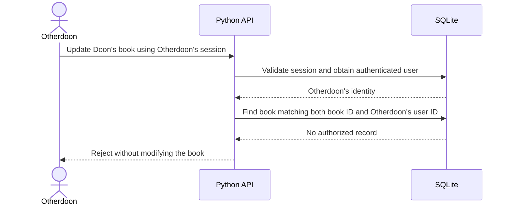

# Secure ebook tracker report notes

Working notes for the 600IT Secure Programming coursework. This is planning material, not a finished report or evidence that the system is secure. Update it as design decisions, implementation changes, and test results become available.

Last updated: 13 October 2026.

## Current status

- The `v0.1.0-insecure` Git tag freezes the baseline. The `v0.1.1-secure` working branch now has password hashing, opaque SQLite-backed sessions, session restore/logout, an admin role check, request-token checks for writes, parameterized search, and plain-text note rendering. This is an intermediate implementation: cross-user ownership checks, login throttling, and verified HTTPS remain outstanding.
- Authentication report point: unknown usernames and wrong passwords now receive the same HTTP 401 and `Username or password does not exist.` response. The baseline named a missing username. The generic response reduces direct account-enumeration clues; it does not replace rate limiting, and the public demo-account hint means these particular usernames are intentionally disclosed.
- The assessment brief has been read, including its marking criteria.
- The proposed project is a small personal ebook reading tracker with separate private libraries for multiple users.
- The intended emphasis is security implementation, testing, and explanation. Interface styling is secondary.
- The React, Flask, and SQLite baseline has been implemented, including username-only entry, book CRUD, title search, cross-user dashboard access, and an unprotected admin API/page.
- For a readable presentation, the baseline search executes client-entered `SELECT * FROM books` and `UPDATE books SET notes = 'Changed through SQL' WHERE id = 4`. These are direct execution of client-supplied SQL, distinct from the original search SQL injection using `' OR 1=1 -- `. Label each screenshot accordingly.
- The frontend build, 10 backend baseline checks, and 10 browser checks passed. Browser checks verified login, persistent create/edit/delete operations, ordinary search, cross-user dashboard access, admin access with and without pseudo-login, SQL injection, harmless stored-script execution, mobile layout, and absence of uncaught JavaScript errors. The browser checks ran against the Vite development site on port 5173, with API requests proxied to Flask. These passing checks characterize the deliberately insecure baseline.
- Flask debug mode and Vite live refresh are available for local development; see [development instructions](docs/DEVELOPMENT.md).
- The hardened version and its security controls remain proposed. Earlier diagrams are design illustrations and need updating to include the baseline pseudo-login and admin page.

## Requirements from the assessment brief

Source: [600IT assessment brief](600IT_PSB_CW2_Assessment_Brief(FT-202309).docx). Page references below refer to the rendered version inspected during planning.

- Design and develop a secure web-based system incorporating endpoint and communications security, and rigorously test its security (pages 1–2).
- Document the development steps in a report of no more than 2,000 words (page 2). Aim below 2,000 rather than relying on the general word-count tolerance.
- Begin the report with a literature review addressing security in the software development lifecycle, secure software engineering, secure programming techniques, standards-based approaches and threat modelling, and tools supporting secure development (page 2).
- The programming topics listed in the brief are suggestions, not a requirement to implement every topic.
- Learning outcomes cover vulnerability analysis and testing, creating software in a range of languages to exploit vulnerabilities, defensive strategies, and secure programming techniques (page 1).
- The title page must identify the module, assessment title, assessment number, and word count. Quotations count toward the word limit; the bibliography is excluded (page 3). Treatment of captions, tables, and appendices should be checked with the module guidance.
- The marking categories are knowledge and understanding (30%), analysis and application (30%), research (20%), and academic writing (20%). The rubric specifies APA 7 referencing (pages 4–6).
- The supplied brief shows a 2023 submission date. It is not evidence of the current deadline; use the current module submission instructions.

Do not reproduce or publish the full assessment brief. These notes summarise requirements needed to plan the work.

## Project scope and rationale

Working title: Secure Personal Ebook Tracker.

The application records book metadata and reading progress; it does not need to store ebook files. Private notes provide a concrete confidentiality requirement. Two demonstration accounts allow realistic tests of access between users.

Minimum functions:

1. Register, log in, and log out.
2. Add a book with title, author, reading status, and private notes.
3. List, view, edit, and delete the authenticated user's own entries.

Initially excluded: file uploads, cover-image fetching, external book APIs, recommendations, social sharing, payments, administrator features, email verification, and password-reset emails. Record the consequences of omissions such as account recovery in the limitations section.

The deliverable should be a small working system with reproducible security demonstrations. A presentation or mock-up alone would not meet the development requirement.

## Proposed architecture

Provisional stack: React frontend, Flask backend, SQLite database, and an HTTPS web server or reverse proxy. Serve frontend and API through one origin to simplify browser integration. Select exact libraries and versions during implementation and record why they were chosen.

SQLite is sufficient for demonstrating parameterized queries and application-level ownership checks. It is a local database file, so host file permissions and keeping the file outside public web directories matter. Do not describe it as providing database-user roles or encrypted storage unless those features are actually implemented.

Report comparison diagrams (matching layouts, fully editable):

- [Figure 1 — Insecure baseline in Excalidraw](diagrams/system-baseline.excalidraw).
- [Figure 2 — Secured design in Excalidraw](diagrams/system-secured.excalidraw).

Figure 1 shows a conceptual system with no deliberately implemented security controls: it trusts client-supplied user IDs, builds unsafe SQL, renders raw notes, and uses HTTP. Figure 2 adds the six proposed security-control groups. Both are design illustrations, not evidence of implemented or tested behaviour. The baseline's absence of authentication means login-throttling experiments will need a separate intermediate version with a functioning login endpoint.

Suggested captions: **Figure 1. Conceptual ebook tracker before deliberate security controls are introduced.** **Figure 2. Proposed ebook tracker after adding authentication, authorization, safe data handling, session protection, throttling, and HTTPS with host hardening.**

The [earlier architecture sketch](diagrams/system-architecture.excalidraw) is retained for reference; use the matched pair above for the report.

Open the `.excalidraw` file in Excalidraw using **Open**, or drag it onto the canvas. All components, labels, arrows, and the application-host trust boundary are editable. Export SVG or PNG from Excalidraw when preparing the report. Keep this file as the source for future architecture changes.

This is a conceptual hardened architecture, not an implementation record. The browser is untrusted. The backend must enforce authentication, authorization, and validation regardless of what the interface permits. If the proxy-to-API connection is local, document that boundary; reassess transport protection if it crosses hosts.

Likely data entities: users, books owned by users, and server-side sessions. Determine book ownership from the authenticated session on creation; do not trust a client-supplied owner ID.

## Before and after approach

### Optional Kali Linux demonstration

Kali is a testing environment, not an application security control. A live USB is optional: it adds boot compatibility, dependency setup, and persistence work that the coursework does not require. If the same computer is rebooted into Kali, the macOS-hosted `127.0.0.1` site will no longer be running; either run the app in Kali or use a separate test machine/VM on an isolated network. Do not expose the intentionally vulnerable baseline to a public network.

For the report, lead with the required literature review, then describe the baseline architecture and threats, a small set of controlled local attacks, the implemented controls, and the same tests repeated against the secured version. Whether requests are sent from Kali, browser developer tools, or automated tests, retain the exact request, response, account context, and database effect. Kali screenshots by themselves do not establish vulnerability or security. Manual authorization tests remain necessary even if a web scanner is used.

### Recommended minimum security scope

For a small working demonstration, implement six groups of controls. This is a proposed scope, not a guarantee of a grade or proof of complete security.

| Suggested build order | Control group | Minimum demonstration |
| --- | --- | --- |
| 1 | Authentication and password hashing | Correct password succeeds, incorrect password fails, and database stores salted password hashes |
| 2 | Ownership authorization | Otherdoon cannot read, change, or delete Doon's books; Doon can |
| 3 | Safe data handling | Bound SQL parameters, field/size validation, and plain-text notes prevent input being treated as SQL or executable HTML |
| 4 | Session and request protection | Protected session cookies, expiry, logout invalidation, and CSRF checks on state changes |
| 5 | Login rate limiting | Excess attempts return 429, with a retry indication; attempts are allowed again after the configured window |
| 6 | HTTPS and basic host hardening | Certificate-validated HTTPS, debug mode off, database outside public paths, and restricted file permissions |

These controls should be integrated as each feature is built. Prioritise three detailed before/after demonstrations: cross-user access, SQL injection, and login throttling. Verify the remaining controls with focused tests and configuration evidence.

Rate limiting is an approachable first isolated exercise, but authentication and ownership are the foundation of a private tracker. Describe the limiter as slowing automated password guessing and reducing repeated expensive login work. Do not claim an application limiter prevents DDoS attacks or guarantees that the server cannot overload. Distributed sources can evade per-IP limits, and bandwidth or upstream infrastructure may be exhausted before requests reach the application.

A possible classroom demonstration policy is five login attempts per minute per source IP, with a sixth attempt receiving 429. This is an illustrative threshold, not a production recommendation. A per-IP-only version must be labelled as limited; account-level controls need consideration of deliberate user lockout. Record the actual policy implemented, trusted-proxy configuration if any, and limiter storage limitations. Use a maintained library. A handful of controlled requests proves throttling behaviour; it does not prove DDoS resilience or load capacity.

Additional source: [OWASP Denial of Service Cheat Sheet](https://cheatsheetseries.owasp.org/cheatsheets/Denial_of_Service_Cheat_Sheet.html), distinguishing application, protocol/session, and network resource exhaustion. Read alongside the Authentication Cheat Sheet's login-throttling guidance.

Maintain a reproducible baseline with selected documented weaknesses and a hardened version with the same core functions. Use local dummy accounts and data for demonstrations. Keep the final runnable default secure; avoid a casual runtime switch that disables security.

Do not claim the baseline has no security: frameworks and libraries may already provide protections. Document exactly which controls are absent. Do not introduce unrelated vulnerabilities merely to make the baseline look worse.

Plan threats before implementation, then use this reporting chain:

**Threat → baseline behaviour → code or configuration change → repeated test → remaining limitation.**

Candidate detailed comparisons:

- Missing record ownership checks.
- SQL constructed unsafely from input; a separate baseline presentation path also accepts a full client-supplied `SELECT` statement.
- Unlimited failed login attempts.

Other controls can be implemented and verified without building a separate vulnerable demonstration for each one.

## Threats and proposed controls

| Asset or operation | Threat | Proposed control | Evidence to collect |
| --- | --- | --- | --- |
| Passwords | Exposure after database theft | Established Argon2id password-hashing library with salts and documented parameters | Stored hash format, configuration, successful and failed verification tests |
| Login | Automated guessing and account enumeration | Throttling and consistent failure responses | Repeated failures trigger limits; recovery after the configured window; comparison of failure responses |
| Private books and notes | Another authenticated user reads or changes a record | Ownership checks on every read, update, delete, and list operation | Cross-user attempts rejected; owner operations succeed; database unchanged after rejected writes |
| Database queries | SQL injection | Bound parameters; server-side field validation | Injection input cannot alter query structure; valid inputs including apostrophes work |
| Sessions | Session theft, fixation, or reuse after logout | Unpredictable session IDs, rotation on login, expiry, invalidation, protected cookies | Rotation, expiry, logout replay, and cookie-attribute checks |
| State-changing requests | Cross-site request forgery | Server-validated CSRF protection and appropriate cookie settings | Missing or invalid token rejected; legitimate request accepted |
| Notes rendered in browser | Script execution through stored content | Render plain text; avoid raw HTML insertion; add appropriate security headers | Script-like content remains inert in a browser test |
| Credentials and session traffic | Network interception or tampering | HTTPS with certificate validation | Actual TLS connection and certificate validation; sensitive operations unavailable over plaintext HTTP |
| Host, database file, and errors | Accidental disclosure or excessive privileges | Restricted file access, no public database path, debug mode off, safe error responses | File permissions, attempted database URL access, and error-response inspection |

Cookie settings should include HttpOnly, Secure when using HTTPS, and an appropriate SameSite policy. SameSite is not a substitute for the planned CSRF checks. Select a maintained session implementation rather than inventing cryptography or token generation.

Login throttling requires a documented policy: account and source dimensions, thresholds, time window, storage, and restart behaviour. Discuss the tradeoff between limiting guessing and allowing attackers to lock out legitimate users. A single-process in-memory limiter has limitations that must be stated if used.

## Initial threat modelling notes

Use a compact STRIDE analysis to connect design to controls. These are candidate mappings to develop, not a completed risk assessment.

| STRIDE category | Relevant scenario | Response to investigate |
| --- | --- | --- |
| Spoofing | Attacker impersonates a user through guessed credentials or a stolen session | Authentication, throttling, session lifecycle |
| Tampering | User changes another user's reading record | Ownership enforcement and validated updates |
| Repudiation | A modification cannot be investigated | Minimal security-event logging without passwords, tokens, or private note contents |
| Information disclosure | Private notes, hashes, or debug information leak | Access control, TLS, file permissions, safe errors |
| Denial of service | Repeated requests or oversized inputs consume resources | Request/input limits and throttling; document residual exposure |
| Elevation of privilege | Ordinary user obtains access outside their permitted records | Deny-by-default authorization and cross-user tests |

Authentication establishes identity; authorization determines permitted actions on particular resources. A successful login does not authorize access to all books. An unpredictable book ID is not a replacement for an ownership check.

## Diagram plan

1. Baseline and hardened component/data-flow diagrams using the same layout. Number the changes and identify trust boundaries, sensitive flows, and storage.
2. A sequence diagram showing Otherdoon attempting to edit Doon's book, including session validation, ownership enforcement, and rejection before mutation.

Keep diagrams small enough to explain in the word budget. They should reflect actual implementation when finalised.

Decide and consistently test the response policy, such as returning 404 for a record the requester cannot access. Also test that Doon's equivalent update succeeds.

## Testing and evidence plan

Use controlled attack scripts and integration/browser tests against the local project. Candidate evidence includes Python request scripts and a JavaScript browser test, supporting the learning outcome involving exploit software in multiple languages. Merely using two languages in the application is not proof of that outcome.

For every security rejection, test a legitimate operation that should still work. Check database state after rejected mutations. Rerun the same relevant requests against both versions with reset, reproducible fixtures.

Suggested evidence record:

| Test ID | Version or commit | Preconditions | Request or action | Expected result | Actual result | Evidence path | Interpretation |
| --- | --- | --- | --- | --- | --- | --- | --- |
| AUTHZ-01 | Ownership working tree after `v0.1.1-auth-foundation` | Doon logged in; Otherdoon and admin have books | Read their profiles, lists, and book IDs | Cross-user requests denied | HTTP 404 for each; 9-test backend suite passed on 14 Oct 2026 | `tests/test_ownership.py` | A valid session alone does not grant access to another user's records |
| AUTHZ-02 | Same working tree | Doon logged in; Otherdoon owns book 4 | Create under user 2; edit and delete book 4 | Denied; stored data unchanged | HTTP 404; book and row count unchanged | `tests/test_ownership.py` | Write authorization is checked on the server |
| AUTHZ-03 | Same working tree | Otherdoon logged in | Read, create, update, and delete own books | Accepted | Reads and writes succeeded; deleted book then returned 404 | `tests/test_ownership.py` | Ownership checks preserve legitimate use |
| SQL-01 | Pending | Seeded database | Submit injection-like input to a query endpoint | Input cannot change SQL structure | Not run | Pending | Pending |
| LOGIN-01 | Pending | Known throttle policy | Repeated failed logins | Limit applied according to policy | Not run | Pending | Pending |
| SESSION-01 | Pending | Valid session then logout | Replay old session | Authentication required | Not run | Pending | Pending |
| CSRF-01 | Pending | Logged-in browser session | State-changing request without valid CSRF token | Rejected; data unchanged | Not run | Pending | Pending |
| XSS-01 | Pending | Stored script-like note | Display note in browser | Text shown; no script execution | Not run | Pending | Pending |
| TLS-01 | Pending | HTTPS configured | Connect with certificate validation enabled | Trusted encrypted connection | Not run | Pending | Pending |

Supplement targeted tests with static analysis, dependency checks, and a scoped dynamic scan if useful. Select tools during implementation and record their versions and limitations. Scanner output alone cannot establish that ownership rules are correct or that the application is secure.

Keep genuine command output, relevant HTTP responses, screenshots, code references, and configuration records. Never invent passing results. Remove credentials, session tokens, and other secrets from report evidence.

## Report outline and word budget

| Part | Approximate words | Purpose |
| --- | ---: | --- |
| Literature review | 450 | Cover the five required areas and justify the methods selected |
| Scope, assets, threats, and architecture | 300 | Establish the problem and security boundaries |
| Implementation and rationale | 550 | Explain the most significant controls and tradeoffs |
| Testing and evaluation | 500 | Present reproducible before/after results and interpret them |
| Limitations and conclusion | 150 | State what the evidence supports and what remains unresolved |
| Total | 1,950 | Leaves a small margin below 2,000 |

The literature review should synthesise sources rather than list definitions. Explain how security is addressed during requirements, design, coding, testing, and maintenance. Use primary technical guidance and relevant academic research; the source list below is only an initial collection, not a sufficient completed literature review.

Possible tradeoffs worth evaluating:

- Password-hashing cost versus login latency and server resources.
- Login throttling versus legitimate-user lockout.
- SQLite's simple deployment versus its concurrency and host-access limitations.
- Session storage and revocation versus additional server-side state.
- Useful security logging versus unnecessary retention of private information.
- A clean scan versus the narrower assurance supplied by specific reproducible tests.

## Initial sources

The following official OWASP pages were located during planning. Recheck the exact sections used when writing the report, record the applicable version or date, and format the final bibliography in APA 7. These working links are not finished academic references.

- [Authorization Cheat Sheet](https://cheatsheetseries.owasp.org/cheatsheets/Authorization_Cheat_Sheet.html): identity versus permissions, deny-by-default decisions, and access-control testing.
- [Password Storage Cheat Sheet](https://cheatsheetseries.owasp.org/cheatsheets/Password_Storage_Cheat_Sheet.html): adaptive password hashing, Argon2id, salts, and cost parameters. Password hashing is not reversible encryption.
- [SQL Injection Prevention Cheat Sheet](https://cheatsheetseries.owasp.org/cheatsheets/SQL_Injection_Prevention_Cheat_Sheet.html): parameterized queries and avoiding concatenation of untrusted input into SQL.
- [Session Management Cheat Sheet](https://cheatsheetseries.owasp.org/cheatsheets/Session_Management_Cheat_Sheet.html): session lifecycle and cookie protections.
- [Authentication Cheat Sheet](https://cheatsheetseries.owasp.org/cheatsheets/Authentication_Cheat_Sheet.html): login throttling and generic authentication failure responses.
- [REST Security Cheat Sheet](https://cheatsheetseries.owasp.org/cheatsheets/REST_Security_Cheat_Sheet.html): HTTPS, endpoint controls, and security headers.

Further research needed: primary secure-development lifecycle guidance, STRIDE methodology, selected verifiable OWASP security requirements, and academic research supporting key tradeoffs. Do not claim standards compliance merely because selected recommendations were followed.

The suggested [Pagefy system design guide](https://www.pagefy.io/system-design/system-design-interview-by-alex-xu) could not be retrieved during planning because requests returned server errors. Its contents have not been reviewed or used as supporting evidence.

## Decisions and results to add as work progresses

- Final stack, dependency versions, and justification.
- Security requirements and their matching tests.
- Baseline and hardened version identifiers and reproducible run instructions.
- Actual database schema, routes, and authorization rules.
- Hashing configuration, session lifetime, cookie policy, CSRF mechanism, and throttle policy.
- HTTPS setup and host/file-access assumptions.
- Test results, failures, fixes, and retest evidence.
- Residual risks and limitations supported by the implemented system.
- Full academic references and final report word count.

Maintain this document as report preparation notes as the project evolves. Clearly distinguish plans, implemented controls, and verified results.
